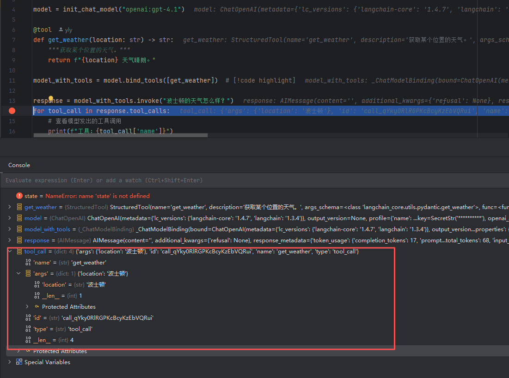

# Agent 篇

### 你如何定义一个基于 LLM 的智能体（Agent）？它通常由哪些核心组件构成？

<strong>参考答案：</strong>
一个基于 LLM 的智能体（Agent）是一个能够自主理解环境、进行规划决策、并执行行动以达成特定目标的计算系统。其核心特征是利用一个<strong>大型语言模型（LLM）作为其“大脑”或“中央处理器”</strong>，来进行复杂的推理和决策。

与传统的调用LLM进行问答或文本生成不同，Agent具有<strong>自主性</strong>和<strong>循环执行</strong>的特点，它能主动地、持续地与环境或工具交互，直到完成任务。

一个典型的LLM Agent通常由以下<strong>四个核心组件</strong>构成：

1.  <strong>大脑/核心引擎 (Brain/Core Engine):</strong>
    * <strong>组件：</strong> 一个强大的大型语言模型（LLM），如GPT系列、Gemini、Llama等。
    * <strong>作用：</strong> 这是Agent的认知核心。它负责理解用户目标、感知环境信息、进行常识推理、制定计划、并决定下一步的行动。所有其他组件的输出最终都会汇集到LLM进行处理。

2.  <strong>规划模块 (Planning Module):</strong>
    * <strong>组件：</strong> 可以是LLM的内置能力（如通过CoT、ReAct等提示策略激发），也可以是独立的算法模块。
    * <strong>作用：</strong> 负责将一个复杂、长期的目标分解成一系列更小、更具体的、可执行的子任务。它还负责根据行动的反馈动态地调整 и修正计划。规划能力是Agent处理复杂任务的关键。

3.  <strong>记忆模块 (Memory Module):</strong>
    * <strong>组件：</strong> 通常是外部数据库或数据结构的组合，如向量数据库、键值存储等。
    * <strong>作用：</strong> 弥补LLM有限的上下文窗口。它分为：
      * <strong>短期记忆：</strong> 记录当前的对话历史、中间步骤的“思考过程”（scratchpad），用于维持任务的连贯性。
      * <strong>长期记忆：</strong> 存储过去的经验、知识、用户偏好等，通过检索（通常是RAG）来为当前决策提供信息。

4.  <strong>工具使用模块 (Tool Use Module):</strong>
    * <strong>组件：</strong> 一系列外部API、函数库或硬件接口。
    * <strong>作用：</strong> 扩展Agent的能力边界。LLM本身无法获取实时信息、执行数学计算或与物理世界交互。工具使用模块允许Agent调用外部工具来完成这些任务，例如：
      * <strong>信息获取：</strong> 调用搜索引擎、数据库查询API。
      * <strong>代码执行：</strong> 运行Python解释器、访问终端。
      * <strong>物理操作：</strong> 控制机器人手臂、调用智能家居API。


### 你怎么设计一个 Agent 系统，让它在接收到模糊多轮指令后，自主完成意图识别、任务分解、动态规划和执行，并在子任务失败时具备自适应调整能力？

#### 一、意图理解

我们没有做独立的 NLU 意图分类模块，而是把意图理解能力下沉到 LLM + 上下文注入，分两层实现：
**第一层：宏观意图 — PlanningAgent 理解"用户想干什么"**
用户输入一句模糊指令，比如"帮我用 hello world 技能打个招呼"，PlanningAgent 需要理解：

- 这是一个单步任务还是多步任务
- 应该派给哪个 agent
- 子任务描述怎么写才能让下游 agent 理解

实现方式是通过 system prompt 注入三类上下文：

1. Agent 合约（<available_agents>）— 告诉 LLM 有哪些 agent 可用及各自能力描述
2. 推理规则（<reasoning_rules>）— 要求 LLM 在 thinking 块中显式推理 6 个问题，包括"哪些 agent 能做"、"我是不是卡住了"
3. 结构化输出（PlanDecision）— 强制 LLM 输出 dispatches 列表而非自由文本，避免意图理解停留在模糊描述

关键点：意图理解不是一次性的。每轮 PlanningAgent 都会收到上一轮的 execution_history，如果发现之前的理解有误（比如派错了 agent、任务描述不清导致失败），可以在下一轮修正。

**第二层：微观意图 — ToolCallingAgent 理解"用什么工具完成"**
当 ToolCallingAgent 收到子任务后，需要进一步理解：用哪个 tool 或 skill 来执行。它的 prompt 注入了：

- 工具上下文（<tool_context>）— 所有可用工具的名称和参数 schema
- 技能上下文（<skill_context>）— 已加载技能的摘要（名称 + 描述 + 文件路径）
- 推理链（<reasoning_rules>）— 要求每步都做 evaluation → memory → next_goal → actions 的完整推理

比如用户说"打个招呼"，ToolCallingAgent 看到 <skill_context> 中有 hello-world 技能的描述匹配，就会输出 {"type": "skill", "name": "hello-world"}。

**面试官：如果 LLM 理解错了怎么办？**
靠闭环反馈修正，而不是靠前置的意图分类器：

- PlanningAgent 的 dispatch 描述写得不好 → ToolCallingAgent 执行失败 → 失败信息回传 → 下一轮 PlanningAgent 看到 FAIL 重新规划
- ToolCallingAgent 选错了工具 → 工具返回错误 → agent 自身的 evaluation_previous_goal 字段会标记失败 → 下一步换工具重试

Prompt 中有一条显式规则："Am I stuck? If repeating the same dispatch, consider an alternative."，这就是防止系统在错误意图上死循环。

>一句话总结： 意图理解 = 上下文注入（agent 合约 + 工具/技能描述）+ LLM 显式推理（thinking block）+ 结构化输出（强制承诺）+ 多轮闭环修正，没有硬编码的意图分类，让 LLM 在充分上下文下自己做判断。

#### 二、多问题分解

> 面试官：你的 Agent 系统是怎么处理一个包含多个子问题的复杂任务的？

回答：
我们用的是 LLM 驱动的动态多轮分解，而非硬编码的任务拆分。具体分三层：

**第一层：分解规则注入**
在 PlanningAgent 的 system prompt 中，我们定义了两条核心规则：

- Task Decomposition — 要求 LLM 把复杂任务拆成最小可执行单元，每个单元映射到一次 agent 调用
- Concurrency — 独立子任务放同一轮并发执行，有依赖的放不同轮顺序执行

这两条规则覆盖了"拆什么"和"怎么排"两个问题。

**第二层：结构化输出**
LLM 不是输出自由文本，而是返回一个强类型的 PlanDecision 结构体，其中 dispatches 字段是一个列表，每个元素包含 agent_name（谁来做）和 task（做什么）。这保证了分解结果是可执行的、可路由的。

比如用户说"分析市场趋势并生成报告"，LLM 会返回：

```json
{
  "dispatches": [
    {"agent_name": "data_agent", "task": "获取市场数据"},
    {"agent_name": "analysis_agent", "task": "分析趋势"}
  ]
}
```

第二轮再 dispatch reporter 生成报告——因为它依赖分析结果。

**第三层：闭环反馈调整**
分解不是一次性的。每轮执行完，所有子任务的结果（成功/失败/错误信息）会作为 execution_history 注入下一轮 prompt。PlanningAgent 看到失败结果后可以：

- 重试同一个 agent
- 换另一个 agent 完成
- 重新分解任务
- 判定整体完成

这个机制通过 prompt 中的 Result Review 规则和 thinking 推理链来驱动，代码层面不做硬编码重试。

>一句话总结： 多问题分解 = Prompt 规则驱动 LLM 拆任务 → 结构化 dispatch 并发/串行执行 → 结果回传闭环调整，核心是让 LLM 当调度器，代码只提供执行框架。


#### 三、任务规划

以 Codex、Manus、Claude 为例，任务规划的典型方式：

##### Codex（OpenAI）

**方式：沙箱 + 单步工具调用循环**

- 没有显式的"规划器"，靠 ReAct 循环：think → act → observe → think
- 每步模型自己决定下一步调用什么工具（bash/代码执行器），没有预生成完整计划
- 优点：简单直接，每步都有真实执行结果反馈
- 缺点：容易陷入局部循环，缺乏全局规划视角，复杂任务效率低


##### Manus

方式：显式 Plan-Execute 分离 + 虚拟文件系统驱动

- 规划阶段：先让 LLM 生成一份完整的 step-by-step plan（类似 todo list）
- 执行阶段：逐步执行 plan 中的任务，每步可调用浏览器、代码沙箱、文件系统等工具
- 动态调整：执行结果不符合预期时，修改剩余 plan 而非重头规划
- 核心特点：用文件系统（.md/.json）作为计划的持久化载体，plan 对外可见可追踪
- 优点：全局视野好，复杂任务拆解清晰
- 缺点：初始规划质量依赖模型能力，plan 本身出错会级联影响后续


##### Claude（Anthropic，特别是 Claude Code / computer use）

**方式：Extended Thinking + 隐式规划**

- 不生成显式 plan 文件，而是在 thinking 推理块中完成隐式的链式推理
- 通过 extended thinking（超长上下文推理）能力，在内部完成"理解 - 分解 - 排序 - 执行"
- 每步输出 thinking + tool_use，本质还是 ReAct，但 reasoning 深度远超普通 ReAct
- 多轮对话中靠 system prompt 注入对话历史 + 工具调用记录维持上下文连贯性

优点：

- reasoning 质量极高，不需要额外规划框架，推理过程细腻自然

缺点：

- 规划过程完全黑盒，用户无法在执行前审核或干预计划
- 超长任务链容易 context window 溢出丢失早期信息
- 无法像 Manus 那样拿到独立 plan 文件来审查修改

##### Devin（Cognition）

方式：Plan-Act-Verify 三阶段 + 持久化工作区

- Plan：接到任务后先输出一份 markdown 计划文件（和你的 plan.md 思路一致）
- Act：按计划逐步操作（编辑器、终端、浏览器），每步都是真实的 IDE 操作
- Verify：每步完成后自动验证（跑测试、检查编译），失败则回到 Plan 阶段修订
- 关键区别：Devin 的规划粒度是"IDE 操作级别"（改哪行代码、跑哪个命令），而 Manus 是"任务级别"

##### Cursor / Windsurf

**方式：Tab 式轻量规划 + 用户确认**

- 不做全自动规划，而是生成一个"建议步骤列表"让用户确认

- 用户可编辑 plan 后再执行，本质是 Human-in-the-loop planning

- 执行阶段是标准的 ReAct（think → edit → verify）

- 优点：可控性强，用户对每一步都有决定权

- 缺点：不适合全自动场景

  

##### OpenAI Operator / Deep Research

方式：多模型协作 + 渐进式规划

- Deep Research：先让模型生成研究计划（research plan），然后按计划并行搜索，每轮评估完整性，不完整则补充搜索——和你的 DeepResearcherTool 几乎一样
- Operator：浏览器操作任务，Plan 阶段生成步骤列表，执行阶段逐步操作 DOM，每步截图验证
- 共同点：都用 o3/o4-mini 级别的推理模型做规划，用轻量模型做执行


#### 行业趋势总结

```
规划模式演进路线：

ReAct（无显式规划）
  ↓
Plan-then-Execute（先规划后执行）
  ↓  
Plan-Execute-Verify（加验证闭环）
  ↓
Multi-Agent Plan（规划者和执行者分离）← 你的项目在这里
  ↓
Self-Evolving Plan（规划策略本身可优化）← 你的 SEPL 在这里
```

| 模式                | 代表      | 规划可见性        | 自动调整              | 多Agent | 自进化 |
| ------------------- | --------- | ----------------- | --------------------- | ------- | ------ |
| ReAct               | Codex     | 无                | 每步自适应            | 否      | 否     |
| Plan-Execute        | Manus     | plan 文件         | 修改剩余 plan         | 否      | 否     |
| Plan-Execute-Verify | Devin     | plan 文件         | 失败回退重规划        | 否      | 否     |
| Human-in-loop       | Cursor    | 用户确认          | 用户决策              | 否      | 否     |
| Multi-Agent Plan    | 你的项目  | plan.md           | 多轮 re-plan          | 是      | 否     |
| Self-Evolving       | 你的 SEPL | plan.md + lineage | propose-assess-commit | 是      | 是     |

你的项目相比业界的主要差异化在于两点：多 Agent 协作规划（PlanningAgent 只做决策、ToolCallingAgent 只做执行）和 SEPL 自进化机制（规划策略本身可以通过 propose-assess-commit 持续优化）。面试时这两个点是加分项。


### 请详细解释 ReAct 框架。它是如何将思维链和行动结合起来，以完成复杂任务的？

ReAct (Reason and Act) 是一个强大且基础的Agent行为框架，它通过一种巧妙的提示（Prompting）策略，让LLM能够协同地生成<strong>推理轨迹（reasoning traces）</strong>和<strong>任务相关的行动（actions）</strong>。

**核心思想：**
ReAct的核心思想是，人类在解决复杂问题时，并不仅仅是“思考”或“行动”，而是将两者紧密地交织在一起。我们会先思考一下，然后采取一个行动，观察结果，再根据结果进行思考，决定下一步行动。ReAct就是模仿人类这种“<strong>思考 -> 行动 -> 观察 -> 思考...</strong>”的循环模式。

<strong>工作流程：</strong>
ReAct通过一个精心设计的Prompt来引导LLM生成特定格式的文本。这个循环的每一步如下：

1.  <strong>思考 (Thought):</strong>
    * LLM首先分析当前的任务目标和已有的信息（观察）。
    * 然后，它会生成一段<strong>内心独白</strong>，即“思考”部分。这部分内容是LLM对当前情况的分析、策略的制定或对下一步行动的规划。例如：“我需要查找一下今天新加坡的天气。我应该使用搜索工具。”
    * 思考过程让Agent的行为变得可解释，并且有助于LLM自己进行复杂的规划和错误修正。

2.  <strong>行动 (Action):</strong>
    * 在“思考”之后，LLM会决定并生成一个具体的、可执行的“行动”。
    * 这个行动通常被格式化为 `Action: [Tool_Name, Tool_Input]` 的形式。例如：`Action: [Search, "weather in Singapore today"]`。
    * `Tool_Name` 是要调用的工具名称，`Tool_Input` 是传递给该工具的参数。

3.  <strong>观察 (Observation):</strong>
    * Agent的外部执行器（harness）会解析LLM生成的“行动”，并<strong>实际调用</strong>对应的工具。
    * 工具执行后返回的结果，被格式化为“观察”信息，并反馈给LLM。例如：`Observation: "Today in Singapore, the weather is sunny with a high of 32°C."`

<strong>循环与结合：</strong>
这个“观察”结果会作为新的上下文，与原始目标一起，输入到LLM中，开始下一轮的“思考 -> 行动 -> 观察”循环。

<strong>如何结合思维链（CoT）和行动？</strong>

* <strong>思维链 (Chain of Thought, CoT)</strong> 是一种让LLM通过生成中间推理步骤来解决复杂问题的方法。
* ReAct中的<strong>思考 (Thought)</strong>部分，本质上就是一种<strong>动态的、交互式的思维链</strong>。
* 传统的CoT是一次性生成所有思考步骤，然后得出答案。而ReAct的“思考”是<strong>每一步行动前</strong>都会进行的、<strong>基于最新观察结果</strong>的思维链。
* 这种结合使得Agent能够：
  * <strong>处理动态环境：</strong> 可以根据工具返回的最新信息实时调整策略。
  * <strong>进行错误修正：</strong> 如果一个行动失败或返回了无用的信息，Agent可以在下一步的“思考”中分析失败原因，并尝试不同的行动。
  * <strong>完成复杂任务：</strong> 通过将大任务分解成一系列“思考-行动”的子步骤，ReAct能够完成需要多步推理和工具交互的复杂任务。

> todo:paln 怎么做到步骤的错误修正


<strong>参考答案：</strong>
规划能力是衡量Agent智能水平的核心指标，它决定了Agent能否有效地将复杂目标分解为可执行步骤。目前，赋予LLM规划能力的主流方法，从简单到复杂，大致可以分为以下几个层次：

1.  <strong>基于提示的隐式规划 (Prompt-based Implicit Planning):</strong>
    * <strong>Chain of Thought (CoT):</strong> 这是最基础的规划方法。通过在提示中加入“Let's think step by step”，引导LLM生成一个线性的、一步接一步的思考过程。这个思考过程本身就是一种简单的计划。
      * <strong>优点：</strong> 实现简单，无需修改模型。
      * <strong>缺点：</strong> 规划是线性的，无法进行探索和回溯。一旦某一步出错，整个计划很可能失败。
    * <strong>ReAct 框架:</strong> ReAct将CoT与行动结合，使得规划成为一个动态过程。每一步的“思考”都是基于前一步“观察”的重新规划，比CoT更具鲁棒性。

2.  <strong>基于搜索的显式规划 (Search-based Explicit Planning):</strong>
    * 这类方法将规划问题形式化为一个搜索问题，通过探索不同的“思考”路径来寻找最优解。
    * <strong>Tree of Thoughts (ToT):</strong>
      * <strong>核心思想：</strong> ToT将规划过程构建为一棵“思维树”。从一个初始问题开始，LLM会生成多个不同的、并行的思考路径（树的分支）。
      * <strong>工作流程：</strong> 它采用标准的树搜索算法（如广度优先或深度优先搜索），在每一步都对当前的所有“思维节点”（叶子节点）进行评估（通常也由LLM自己打分），然后选择最有希望的节点进行下一步的扩展。
      * <strong>优点：</strong> 允许模型进行探索、评估和回溯，能解决需要深思熟虑或多路径探索的复杂问题。
      * <strong>缺点：</strong> 计算开销大，因为需要维护和评估一整棵树。

    * <strong>Graph of Thoughts (GoT):</strong>
      * <strong>核心思想：</strong> GoT是对ToT的进一步泛化。它认为思维过程不一定是树状的，而更可能是图状的。
      * <strong>工作流程：</strong> GoT允许不同的思维路径（分支）进行<strong>合并（Merge）</strong>，将多个子问题的解汇集起来形成一个更复杂的解。它还允许<strong>循环（Cycle）</strong>，使得思维过程可以迭代地优化和精炼。
      * <strong>优点：</strong> 提供了比树更灵活的思维结构，能够解决需要整合不同信息流或迭代改进的、更复杂的规划问题。
      * <strong>缺点：</strong> 结构和实现比ToT更复杂。

3.  <strong>基于任务分解的规划 (Task Decomposition Planning):</strong>
    * <strong>方法：</strong> 训练或提示LLM充当一个“规划器”，将主任务显式地分解成一个依赖图或一个步骤列表。然后，另一个“执行器”LLM（或同一个LLM扮演不同角色）再去逐一完成这些子任务。
    * <strong>优点：</strong> 结构清晰，易于管理和监控任务进度。
    * <strong>缺点：</strong> 对LLM的分解能力要求很高，且预先分解的计划可能缺乏对动态变化的适应性。


### 在 Agent 的设计中，“规划能力”至重要。请谈谈目前有哪些主流方法可以赋予 LLM 规划能力？（例如 CoT, ToT, GoT等）

规划能力是衡量Agent智能水平的核心指标，它决定了Agent能否有效地将复杂目标分解为可执行步骤。目前，赋予LLM规划能力的主流方法，从简单到复杂，大致可以分为以下几个层次：

1.  <strong>基于提示的隐式规划 (Prompt-based Implicit Planning):</strong>
    * <strong>Chain of Thought (CoT):</strong> 这是最基础的规划方法。通过在提示中加入“Let's think step by step”，引导LLM生成一个线性的、一步接一步的思考过程。这个思考过程本身就是一种简单的计划。
      * <strong>优点：</strong> 实现简单，无需修改模型。
      * <strong>缺点：</strong> 规划是线性的，无法进行探索和回溯。一旦某一步出错，整个计划很可能失败。
    * <strong>ReAct 框架:</strong> ReAct将CoT与行动结合，使得规划成为一个动态过程。每一步的“思考”都是基于前一步“观察”的重新规划，比CoT更具鲁棒性。

2.  <strong>基于搜索的显式规划 (Search-based Explicit Planning):</strong>
    * 这类方法将规划问题形式化为一个搜索问题，通过探索不同的“思考”路径来寻找最优解。
    * <strong>Tree of Thoughts (ToT):</strong>
      * <strong>核心思想：</strong> ToT将规划过程构建为一棵“思维树”。从一个初始问题开始，LLM会生成多个不同的、并行的思考路径（树的分支）。
      * <strong>工作流程：</strong> 它采用标准的树搜索算法（如广度优先或深度优先搜索），在每一步都对当前的所有“思维节点”（叶子节点）进行评估（通常也由LLM自己打分），然后选择最有希望的节点进行下一步的扩展。
      * <strong>优点：</strong> 允许模型进行探索、评估和回溯，能解决需要深思熟虑或多路径探索的复杂问题。
      * <strong>缺点：</strong> 计算开销大，因为需要维护和评估一整棵树。

    * <strong>Graph of Thoughts (GoT):</strong>
      * <strong>核心思想：</strong> GoT是对ToT的进一步泛化。它认为思维过程不一定是树状的，而更可能是图状的。
      * <strong>工作流程：</strong> GoT允许不同的思维路径（分支）进行<strong>合并（Merge）</strong>，将多个子问题的解汇集起来形成一个更复杂的解。它还允许<strong>循环（Cycle）</strong>，使得思维过程可以迭代地优化和精炼。
      * <strong>优点：</strong> 提供了比树更灵活的思维结构，能够解决需要整合不同信息流或迭代改进的、更复杂的规划问题。
      * <strong>缺点：</strong> 结构和实现比ToT更复杂。

3.  <strong>基于任务分解的规划 (Task Decomposition Planning):</strong>
    * <strong>方法：</strong> 训练或提示LLM充当一个“规划器”，将主任务显式地分解成一个依赖图或一个步骤列表。然后，另一个“执行器”LLM（或同一个LLM扮演不同角色）再去逐一完成这些子任务。
    * <strong>优点：</strong> 结构清晰，易于管理和监控任务进度。
    * <strong>缺点：</strong> 对LLM的分解能力要求很高，且预先分解的计划可能缺乏对动态变化的适应性。


### Memory是 Agent 的一个关键模块。请问如何为 Agent 设计短期记忆和长期记忆系统？可以借助哪些外部工具或技术？

记忆模块是Agent打破LLM上下文窗口限制、实现持续学习和个性化的关键。设计Agent的记忆系统通常会模仿人类的记忆机制，分为短期记忆和长期记忆。

<strong>1. 短期记忆 (Short-Term Memory):</strong>

* **作用：**存储当前任务的上下文信息，包括即时对话历史、中间的思考步骤（如ReAct的Scratchpad）、工具的调用结果等。它是Agent进行连贯思考和行动的基础。
* **实现方式：**
  * <strong>LLM的上下文窗口 (Context Window):</strong> 这是最直接的短期记忆载体。所有最近的交互都会被放入Prompt中。
  * <strong>缓冲区 (Buffers):</strong> 在Agent框架（如LangChain）中，通常会使用不同类型的缓冲区来管理对话历史，例如：
    * <strong>ConversationBufferMemory:</strong> 存储完整的对话历史。
    * <strong>ConversationBufferWindowMemory:</strong> 只保留最近的K轮对话。
    * <strong>ConversationSummaryBufferMemory:</strong> 在历史对话过长时，动态地用LLM进行总结，以节省Token。
  * <strong>暂存器 (Scratchpad):</strong> 用于记录ReAct框架中的“Thought-Action-Observation”轨迹，是Agent进行逐步推理的关键。

<strong>2. 长期记忆 (Long-Term Memory):</strong>

* <strong>作用：</strong> 存储跨越任务和时间维度的信息，如用户的个人偏好、过去的成功/失败经验、领域知识等。它使得Agent能够“学习”和“成长”。
* <strong>实现方式与外部工具：</strong> 长期记忆的核心是“<strong>存储</strong>”和“<strong>检索</strong>”，这通常需要借助外部技术，最主流的是<strong>RAG (Retrieval-Augmented Generation)</strong> 范式。
  * <strong>核心技术：向量数据库 (Vector Database)</strong>
    * <strong>工具：</strong> Pinecone, ChromaDB, FAISS, Weaviate等。
    * <strong>工作流程：</strong>
      1.  <strong>存储（Storing/Writing）：</strong> 当Agent获得一个有价值的信息（如用户明确给出的偏好、一个成功解决问题的完整流程）时，它会使用一个<strong>嵌入模型（Embedding Model）</strong>将这段文本信息转换成一个高维向量。然后，将这个向量及其原始文本存入向量数据库。
      2.  <strong>检索（Retrieving/Reading）：</strong> 在Agent进行规划或决策时，它会把当前的任务或问题也转换成一个查询向量。然后，用这个查询向量去向量数据库中进行<strong>相似度搜索</strong>，找出与当前情况最相关的历史记忆。
      3.  <strong>使用（Using）：</strong> 检索到的记忆（原始文本）会被插入到LLM的Prompt中，作为额外的上下文，来指导LLM做出更明智的决策。
  * <strong>其他技术：</strong>
    * <strong>传统数据库/知识图谱：</strong> 对于结构化或关系型数据，使用SQL数据库或图数据库（如Neoj）进行存储和精确查询也是一种有效的长期记忆形式。


### Tool Use是扩展 Agent 能力的有效途径。请解释 LLM 是如何学会调用外部 API 或工具的？（可以从 Function Calling 的角度解释）

LLM学会调用外部API或工具，是其从一个纯粹的“语言模型”转变为一个“行动执行者”的关键一步。这一能力的核心是让LLM能够<strong>理解何时需要使用工具</strong>，以及<strong>如何以结构化的方式表达使用哪个工具和传递什么参数</strong>。目前，主流的实现方式是<strong>Function Calling</strong>。

**Function Calling的工作原理如下：**

1. <strong>工具定义与注册 (Tool Definition & Registration):</strong>

   * 我们首先需要以一种机器可读的方式，向LLM“描述”我们有哪些可用的工具。这个描述通常是一个<strong>结构化的模式（Schema）</strong>，比如JSON Schema。
   * 对于每一个工具，我们需要定义：
     * <strong>函数名称 (Function Name):</strong> 例如，`get_current_weather`。
     * <strong>函数描述 (Function Description):</strong> 用自然语言清晰地描述这个函数的功能。例如，“获取指定城市的实时天气信息”。这个描述至关重要，因为LLM会根据它来判断何时使用该工具。
     * <strong>参数列表 (Parameters):</strong> 定义函数需要哪些输入参数，每个参数的名称、类型、和描述。例如，参数 `location` (string, "城市名") 和 `unit` (enum, "温度单位，可以是celsius或fahrenheit")。

2. <strong>LLM的决策与意图识别 (LLM's Decision & Intent Recognition):</strong>

   * 在与用户交互时，我们将用户的提问<strong>连同所有已注册的工具描述</strong>一起发送给LLM。
   * LLM（如GPT-4, Gemini等）经过了特殊的指令微调，使其能够理解这种“工具描述”的格式。
   * LLM会分析用户的意图。如果它认为只靠自身知识无法回答，且用户的意图与某个工具的功能相匹配，它就会决定调用该工具。

3. <strong>生成结构化的调用指令 (Generating Structured Calling Instructions):</strong>

   * 当LLM决定调用工具时，它的输出<strong>不再是自然语言文本</strong>，而是一个特殊格式的、结构化的<strong>JSON对象</strong>（或其他格式）。

   * 这个JSON对象会精确地包含：

     * <strong>要调用的函数名称</strong>。
     * <strong>一个包含所有参数名和值的对象</strong>。

   * 例如，对于用户提问“今天新加坡天气怎么样？”，LLM可能输出：

     ```json
     {
       "tool_call": {
         "name": "get_current_weather",
         "arguments": {
           "location": "Singapore",
           "unit": "celsius"
         }
       }
     }
     ```

4. <strong>外部执行与结果返回 (External Execution & Result Return):</strong>

   * Agent的控制代码（Orchestrator）会捕获这个特殊的JSON输出。
   * 它会解析JSON，找到函数名和参数，然后在<strong>外部环境中实际执行</strong>这个函数（例如，调用一个真实的天气API）。
   * 函数执行完毕后，会返回一个结果（例如，`{"temperature": 32, "condition": "sunny"}`）。

5. <strong>整合结果并生成最终回复 (Integrating Result & Generating Final Response):</strong>

   * 控制代码将工具的返回结果<strong>再次格式化</strong>，并将其作为新的上下文信息，连同之前的对话历史一起，再次发送给LLM。
   * 这一次，LLM已经获得了它需要的信息。它会基于这个结果，生成一个最终的、流畅的自然语言回答给用户，例如：“今天新加坡的天气是晴天，温度为32摄氏度。”


#### 真实示例

工具调用代码：

```python
import json
from langchain.tools import tool
from langchain.chat_models import init_chat_model

model = init_chat_model("openai:gpt-4.1")

@tool
def get_weather(location: str) -> str:
    """获取某个位置的天气。"""
    return f"{location} 天气晴朗。"

# ===== 查看 @tool 自动生成的 Schema =====
print("=== @tool 生成的 args_schema (JSON Schema) ===")
print(json.dumps(get_weather.args_schema.model_json_schema(), indent=2, ensure_ascii=False))

# ===== 查看 bind_tools 转换后发给 LLM 的格式 =====
print("\n=== bind_tools 转换后的 OpenAI tools 格式 ===")
# 将 tool 转换为 OpenAI 格式的 tool dict
from langchain_core.utils.function_calling import convert_to_openai_tool
print(json.dumps(convert_to_openai_tool(get_weather), indent=2, ensure_ascii=False))

model_with_tools = model.bind_tools([get_weather])  # [!code highlight]

response = model_with_tools.invoke("波士顿的天气怎么样？")
for tool_call in response.tool_calls:
    # 查看模型发出的工具调用
    print(f"工具：{tool_call['name']}")
    print(f"参数：{tool_call['args']}")
```

在当前代码中，你看不到 JSON Schema——但它确实在背后生成了。整个流程分为两层：
第一层：@tool 装饰器 → 自动生成 Schema

```python
@tool
def get_weather(location: str) -> str:
    """获取某个位置的天气。"""
    return f"{location} 天气晴朗。"
```

**@tool 装饰器做了以下事情：**

| 从代码中提取                         | 生成的 Schema 字段                            |
| ------------------------------------ | --------------------------------------------- |
| 函数名 get_weather                   | function.name                                 |
| docstring """获取某个位置的天气。""" | function.description                          |
| 参数 location: str                   | parameters.properties.location (type: string) |
| 返回类型 -> str                      | 不发送给 LLM，仅内部使用）                    |

**第二层：bind_tools → 转换为 LLM 提供商格式**

```python
model_with_tools = model.bind_tools([get_weather])
```

bind_tools 会将上面的 Schema 转换为 OpenAI API 要求的格式，最终发送给 OpenAI 的请求体中会包含类似这样的 JSON：
```json
{
  "tools": [
    {
      "type": "function",
      "function": {
        "name": "get_weather",
        "description": "获取某个位置的天气。",
        "parameters": {
          "type": "object",
          "properties": {
            "location": {
              "type": "string"
            }
          },
          "required": ["location"]
        }
      }
    }
  ]
}
```

现在运行这个文件，你会看到两段 JSON 输出：
**输出 1：@tool 生成的原始 JSON Schema**

```json
=== @tool 生成的 args_schema (JSON Schema) ===
{
  "description": "获取某个位置的天气。",
  "properties": {
    "location": {
      "title": "Location",
      "type": "string"
    }
  },
  "required": [
    "location"
  ],
  "title": "get_weather",
  "type": "object"
}
```

这是 Pydantic 根据你的函数签名自动生成的标准 JSON Schema。

**输出 2：bind_tools 转换后的 OpenAI 格式**

```json
=== bind_tools 转换后的 OpenAI tools 格式 ===
{
  "type": "function",
  "function": {
    "name": "get_weather",
    "description": "获取某个位置的天气。",
    "parameters": {
      "properties": {
        "location": {
          "type": "string"
        }
      },
      "required": [
        "location"
      ],
      "type": "object"
    }
  }
}
```

**整个流程总结**

```
Python 函数                    @tool 装饰器                   bind_tools
─────────────                  ──────────                    ──────────
def get_weather(location: str)  →  Pydantic Model  →  OpenAI tools JSON  →  发送给 LLM
    """获取某个位置的天气。"""       (JSON Schema)      (function calling 格式)
```

核心要点：

- 函数名 → name
- docstring → description（LLM 靠它判断何时调用）
- 参数类型注解 → parameters（LLM 靠它知道要传什么参数）
- 这一切都是自动完成的，LangChain 帮你隐藏了 Schema 生成的复杂性

**当LLM决定调用工具时，它的输出一个特殊格式的、结构化的JSON对象**



### MCP协议

#### **一、先看问题：没有 MCP 之前世界是什么样的**

假设你是一个开发者，想让 AI 助手帮你做三件事：查天气、读数据库、发 Slack 消息。
没有 MCP 的时代：

```
                        ┌─ 天气 API ──── 你要写一套对接代码（REST 调用）
Claude Desktop ─────────┤─ 数据库 ────── 你要写一套对接代码（SQL 连接）
                        └─ Slack ─────── 你要写一套对接代码（Webhook）

                        ┌─ 天气 API ──── 又要重新写一套（格式不同！）
Cline (VS Code) ────────┤─ 数据库 ────── 又要重新写一套
                        └─ Slack ─────── 又要重新写一套

                        ┌─ 天气 API ──── 还得再写一套
你的自研 Agent ───────────┤─ 数据库 ────── 还得再写一套
                        └─ Slack ─────── 还得再写一套

总共 3 × 3 = 9 种对接方式，每种都是"烟囱式"的定制开发
```

每个 AI 客户端有自己的插件格式，每个工具有自己的 API 风格。这就是 N × M 集成困境。

有了 MCP 之后：

```
Claude Desktop ──┐
                 │
Cline ───────────┼── MCP ──→ MCP Servers ──→ Weather
                 │                    ├──────→ Database
Your Agent ──────┘                    └──────→ Slack


每个工具只开发 1 个 MCP Server
每个客户端只实现 1 个 MCP Client

总共 3 + 3 = 6，而且各自独立开发，互不影响
```

#### 二、MCP 协议到底定义了什么

MCP 协议本质上是一份合同规范，规定了客户端和服务端之间"怎么对话"。这份合同包含三个层面：

##### 层面 1：消息格式 — "用什么语言说话"

MCP 选择了 JSON-RPC 2.0 作为消息格式。每条消息都长这样：

```json
// 请求（客户端 → 服务端）
{
  "jsonrpc": "2.0",        // 固定版本号
  "method": "tools/list",  // 要做什么
  "id": 2                  // 请求编号，用于匹配响应
}

// 响应（服务端 → 客户端）
{
  "jsonrpc": "2.0",
  "result": { ... },       // 执行结果
  "id": 2                  // 对应请求的编号
}
```

这跟你在 client_handshake_demo.py 里打印出来的完全一致。

JSON-RPC 有三种消息类型：

| 类型         | 类型               | 例子                                    |
| ------------ | ------------------ | --------------------------------------- |
| Request      | 请求，期望对方回复 | tools/list（给我工具列表）              |
| Response     | 对 Request 的回复  | 返回工具列表的 JSON                     |
| Notification | 通知，不需要回复   | notifications/initialized（我准备好了） |

你在 demo 里也看到了 —— notifications/initialized 发送后没有等待响应，因为它是通知类型。

##### **层面 2：传输方式 — "用什么管道传输"**

MCP 定义了两种传输方式：
```
方式 A：SSE（Server-Sent Events）—— 远程通信
────────────────────────────────────────────
  客户端                              服务端
    │                                    │
    │── GET /sse ───────────────────────>│  建立 SSE 长连接（一直开着）
    │<── event: endpoint ───────────────│  服务端告诉客户端：发请求用这个URL
    │                                    │
    │── POST /messages/?session_id=xxx ─>│  客户端发 JSON-RPC 请求
    │   (HTTP 202, 空 body)              │  （POST 只是"投递"，不带结果）
    │                                    │
    │<── event: message ────────────────│  服务端通过 SSE 推送 JSON-RPC 响应
    │   (data: {"jsonrpc":"2.0",...})    │
    │                                    │


方式 B：stdio（标准输入/输出）—— 本地通信
────────────────────────────────────────────
  客户端（父进程）              服务端（子进程）
    │                              │
    │── stdin 写入 JSON-RPC ──────>│  客户端把请求写到子进程的标准输入
    │                              │
    │<── stdout 读出 JSON-RPC ────│  服务端把响应写到标准输出
    │                              │
```

SE 适合远程服务（比如你的 server.py 跑在某个服务器上），stdio 适合本地工具（比如 Claude Desktop 在本地启动一个 MCP Server 进程）。

##### 层面 3：协议方法 — "具体说哪些话"

MCP 协议定义了一组标准方法（就像 HTTP 定义了 GET、POST、PUT 一样）：
```
┌─────────────────────────────────────────────────────────────────┐
│                    MCP 协议定义的标准方法                          │
├─────────────────────────────────────────────────────────────────┤
│                                                                 │
│  生命周期管理：                                                  │
│  ├── initialize          客户端说："我要连你，这是我的能力"        │
│  ├── initialized         客户端说："好的，握手完成"               │
│  └── ping                任意一方说："你还活着吗？"               │
│                                                                 │
│  Tools（工具）：                                                 │
│  ├── tools/list          客户端说："你有哪些工具？"               │
│  └── tools/call          客户端说："调用 get_weather 这个工具"    │
│                                                                 │
│  Resources（资源）：                                             │
│  ├── resources/list      客户端说："你有哪些资源？"               │
│  ├── resources/read      客户端说："读一下 weather://tokyo"       │
│  └── resources/templates/list  客户端说："有哪些资源模板？"        │
│                                                                 │
│  Prompts（提示词模板）：                                          │
│  ├── prompts/list        客户端说："你有哪些提示词模板？"          │
│  └── prompts/get         客户端说："给我 weather_report 模板"     │
│                                                                 │
│  Sampling（采样 — 服务端反过来请求客户端）：                       │
│  └── sampling/createMessage  服务端说："帮我问问 LLM 这个事"      │
│                                                                 │
└─────────────────────────────────────────────────────────────────┘
```

#### 三、用你的代码把协议"落地"

你的 server.py 只有 27 行，但它背后做的事情是：

```python
from mcp.server.fastmcp import FastMCP

mcp = FastMCP("Weather Service")   # ① 创建 MCP Server，声明服务名

@mcp.tool()                         # ② 注册一个 Tool
def get_weather(location: str) -> str:
    """Get the current weather for a specified location."""
    return f"Weather in {location}: Sunny, 72°F"

@mcp.resource("weather://{location}")  # ③ 注册一个 Resource
def weather_resource(location: str) -> str:
    return f"Weather data for {location}: Sunny, 72°F"

@mcp.prompt()                       # ④ 注册一个 Prompt
def weather_report(location: str) -> str:
    return f"""You are a weather reporter..."""

mcp.run(transport="sse")            # ⑤ 启动 SSE 传输，监听端口 8000
```

FastMCP 框架在背后自动帮你做了这些事：

| 你写的代码      | 框架自动生成的 MCP 响应                                      |
| --------------- | ------------------------------------------------------------ |
| @mcp.tool()     | tools/list 返回 {"name": "get_weather", "inputSchema": {...}} |
| @mcp.resource() | resources/list 返回 {"uri": "weather://{location}", ...}     |
| @mcp.prompt()   | prompts/list 返回 {"name": "weather_report", ...}            |
| mcp.run()       | 启动 HTTP 服务器，挂载 /sse 和 /messages/ 路由               |

你在 demo 脚本中看到的 tools/list 响应，就是这个 Server 自动生成的：
```json
{
  "tools": [
    {
      "name": "get_weather",
      "description": "Get the current weather for a specified location.",
      "inputSchema": {
        "type": "object",
        "properties": {
          "location": { "type": "string" }
        },
        "required": ["location"]
      }
    }
  ]
}
```

AI 客户端（如 Cline）拿到这个 JSON 后就知道："哦，有个 get_weather 工具，需要传一个 location 字符串参数"。然后当用户问"新加坡天气怎么样"时，AI 就会生成一个 tools/call 请求：
```json
{
  "method": "tools/call",
  "params": {
    "name": "get_weather",
    "arguments": { "location": "Singapore" }
  }
}
```

#### 四、完整时序图：从连接到使用

把以上所有内容串起来，一次完整的 MCP 交互长这样：
```
Cline (MCP Client)                            你的 server.py (MCP Server)
      │                                              │
      │  ── 第一阶段：建立连接 ──                      │
      │                                              │
      │══ GET /sse ═════════════════════════════════>│  建立 SSE 长连接
      │<══ event: endpoint ══════════════════════════│  "/messages/?session_id=abc"
      │                                              │
      │  ── 第二阶段：握手 ──                          │
      │                                              │
      │── POST initialize ──────────────────────────>│  "我是 Cline，支持这些能力"
      │<══ SSE: initialize response ════════════════│  "我是 Weather Service，支持 tools/resources/prompts"
      │── POST initialized ─────────────────────────>│  "好的，握手完成"（通知，无响应）
      │                                              │
      │  ── 第三阶段：发现 ──                          │
      │                                              │
      │── POST tools/list ──────────────────────────>│  "你有哪些工具？"
      │<══ SSE: [{"name":"get_weather",...}] ═══════│  "有 get_weather，参数是 location"
      │── POST resources/list ──────────────────────>│  "你有哪些资源？"
      │<══ SSE: [{"uri":"weather://..."}] ══════════│  "有 weather://{location} 资源"
      │── POST prompts/list ────────────────────────>│  "你有哪些提示词？"
      │<══ SSE: [{"name":"weather_report"}] ════════│  "有 weather_report 提示词"
      │                                              │
      │  ── 第四阶段：使用 ──                          │
      │                                              │
      │── POST tools/call ──────────────────────────>│  "调用 get_weather，location=Singapore"
      │                                              │  → 执行你的 Python 函数
      │<══ SSE: "Sunny, 72°F" ══════════════════════│  ← 返回函数执行结果
      │                                              │
      │  ── 更多调用... ──                            │
      │                                              │
      │── POST tools/call ──────────────────────────>│  "调用 get_weather，location=Tokyo"
      │<══ SSE: "Sunny, 72°F" ══════════════════════│
```

#### 五、一句话总结

MCP = JSON-RPC 2.0（消息格式） + SSE/stdio（传输方式） + 标准方法集（工具/资源/提示词）
它不是某个框架或 SDK，而是一份协议规范 —— 只要你的程序能收发 JSON-RPC 消息、实现那几个标准方法，你就是一个合规的 MCP Server 或 MCP Client。就像任何能处理 HTTP 请求/响应的程序都是 Web 服务器一样。

#### 真实示例

```sh
D:\Anaconda\envs\python_all\python.exe D:\allevery\python_all\mcp\sdk_example\client_handshake_demo.py 
🔌 MCP 协议握手全过程演示
   目标服务: http://localhost:8000


############################################################
  步骤 0：连接 SSE 端点，获取消息发送地址
############################################################
  ✅ 收到消息端点: http://localhost:8000/messages/?session_id=30689645d59e487a919d5e46dcd74e1e
  ✅ SSE 监听线程已启动（复用同一连接/session）

############################################################
  步骤 1：initialize — 客户端告知自身能力，请求初始化
############################################################

============================================================
  →  客户端发送: initialize
============================================================
{
  "jsonrpc": "2.0",
  "method": "initialize",
  "params": {
    "protocolVersion": "2024-11-05",
    "capabilities": {},
    "clientInfo": {
      "name": "HandshakeDemoClient",
      "version": "1.0.0"
    }
  },
  "id": 1
}
  (HTTP POST 返回: 202，空 body = 服务端已接收)

============================================================
  ←  服务端响应 (通过SSE推送): initialize
============================================================
{
  "jsonrpc": "2.0",
  "id": 1,
  "result": {
    "protocolVersion": "2024-11-05",
    "capabilities": {
      "experimental": {},
      "prompts": {
        "listChanged": false
      },
      "resources": {
        "subscribe": false,
        "listChanged": false
      },
      "tools": {
        "listChanged": false
      }
    },
    "serverInfo": {
      "name": "Weather Service",
      "version": "1.25.0"
    }
  }
}

############################################################
  步骤 2：initialized — 客户端确认初始化完成
############################################################

============================================================
  →  客户端发送: notifications/initialized
============================================================
{
  "jsonrpc": "2.0",
  "method": "notifications/initialized"
}
  (HTTP POST 返回: 202，空 body = 服务端已接收)
  ← (通知，服务端不会返回响应)

############################################################
  步骤 3：tools/list — 🔑 客户端主动拉取服务端所有工具
############################################################

============================================================
  →  客户端发送: tools/list
============================================================
{
  "jsonrpc": "2.0",
  "method": "tools/list",
  "id": 2
}
  (HTTP POST 返回: 202，空 body = 服务端已接收)

============================================================
  ←  服务端响应 (通过SSE推送): tools/list
============================================================
{
  "jsonrpc": "2.0",
  "id": 2,
  "result": {
    "tools": [
      {
        "name": "get_weather",
        "description": "Get the current weather for a specified location.",
        "inputSchema": {
          "properties": {
            "location": {
              "title": "Location",
              "type": "string"
            }
          },
          "required": [
            "location"
          ],
          "title": "get_weatherArguments",
          "type": "object"
        },
        "outputSchema": {
          "properties": {
            "result": {
              "title": "Result",
              "type": "string"
            }
          },
          "required": [
            "result"
          ],
          "title": "get_weatherOutput",
          "type": "object"
        }
      }
    ]
  }
}

############################################################
  步骤 4：resources/list — 客户端主动拉取服务端所有资源
############################################################

============================================================
  →  客户端发送: resources/list
============================================================
{
  "jsonrpc": "2.0",
  "method": "resources/list",
  "id": 3
}
  (HTTP POST 返回: 202，空 body = 服务端已接收)

============================================================
  ←  服务端响应 (通过SSE推送): resources/list
============================================================
{
  "jsonrpc": "2.0",
  "id": 3,
  "result": {
    "resources": []
  }
}

############################################################
  步骤 5：prompts/list — 客户端主动拉取服务端所有提示词
############################################################

============================================================
  →  客户端发送: prompts/list
============================================================
{
  "jsonrpc": "2.0",
  "method": "prompts/list",
  "id": 4
}
  (HTTP POST 返回: 202，空 body = 服务端已接收)

============================================================
  ←  服务端响应 (通过SSE推送): prompts/list
============================================================
{
  "jsonrpc": "2.0",
  "id": 4,
  "result": {
    "prompts": [
      {
        "name": "weather_report",
        "description": "Create a weather report prompt.",
        "arguments": [
          {
            "name": "location",
            "required": true
          }
        ]
      }
    ]
  }
}

############################################################
  步骤 6：tools/call — 客户端实际调用 get_weather 工具
############################################################

============================================================
  →  客户端发送: tools/call
============================================================
{
  "jsonrpc": "2.0",
  "method": "tools/call",
  "params": {
    "name": "get_weather",
    "arguments": {
      "location": "Singapore"
    }
  },
  "id": 5
}
  (HTTP POST 返回: 202，空 body = 服务端已接收)

============================================================
  ←  服务端响应 (通过SSE推送): tools/call
============================================================
{
  "jsonrpc": "2.0",
  "id": 5,
  "result": {
    "content": [
      {
        "type": "text",
        "text": "Weather in Singapore: Sunny, 72°F"
      }
    ],
    "structuredContent": {
      "result": "Weather in Singapore: Sunny, 72°F"
    },
    "isError": false
  }
}


============================================================
  ✅ 握手全过程完成！
============================================================

  核心要点：
  ┌──────────────┐                              ┌───────────┐
  │    Client     │                              │ MCP Server│
  │   (Cline)    │                              │(server.py)│
  └──────┬───────┘                              └─────┬─────┘
         │                                            │
         │═══ GET /sse (建立SSE长连接) ═══════════════>│
         │<══ SSE event "endpoint" ═══════════════════│  服务端告知POST地址
         │    (含 session_id，后续必须用同一个)          │
         │                                            │
         │─── POST /messages/?session_id=xxx ─────────>│  客户端发请求
         │    (HTTP 202 空 body，仅表示"已接收")         │
         │                                            │
         │<══ SSE event "message" (JSON-RPC) ════════│  服务端通过同一SSE连接推送响应
         │                                            │
    

Process finished with exit code 0

```


### Skill 深度原理解析：从 Function Calling 到 Skill Context Protocol

#### 一、Tool vs Skill：两种扩展 Agent 能力的范式

在理解 Skill 之前，需要先理解它与 Tool 的本质区别。本项目同时实现了两套协议，形成了一种双轨制的能力扩展体系：

| 维度        | Tool (TCP)                           | Skill (SCP)                                     |
| ----------- | ------------------------------------ | ----------------------------------------------- |
| 定义方式    | Python 类（继承 Tool）               | Markdown 包（SKILL.md + scripts/ + resources/） |
| Schema 生成 | 自动从类签名生成 JSON Schema         | 从 YAML frontmatter 解析元数据                  |
| 注册方式    | @TOOL.register_module 装饰器         | SCP Server 扫描目录或运行时注册                 |
| 告知 LLM    | Function Calling 格式（结构化 JSON） | Prompt Injection（XML 标签包裹的文本摘要）      |
| 执行机制    | 定性代码执行（Python __call__）      | LLM 解释执行（SKILL.md 内容 + 用户参数 → LLM）  |
| 本质        | 刚性工具：代码即逻辑                 | 柔性知识包：Markdown 即指令                     |

核心洞察：Tool 是给机器执行的，Skill 是给 LLM 阅读的。

#### 二、Skill 的完整生命周期

##### 2.1 Skill 的定义：以 Markdown 为中心的知识包

一个 Skill 是一个自包含的目录，其结构如下（以 hello_world 为例）：
```
hello_world/
├── SKILL.md                    # 核心：YAML frontmatter + 完整的Markdown指令
├── scripts/
│   └── hello.py                # 可选：可执行的Python脚本
├── resources/
│   └── greetings.json          # 可选：数据/配置文件
├── examples.md                 # 可选：用法示例文档
└── reference.md                # 可选：API参考文档
```

SKILL.md 是 Skill 的灵魂，其结构为：

```markdown
---
name: hello-world
description: A demonstration skill that greets users...
---

# Hello World Skill
## Quick Start
## Instructions
## Workflow
## Examples
...
```

- YAML frontmatter（--- 之间的部分）：提供机器可读的元数据（名称、描述、版本）
- Markdown body：提供 LLM 可读的完整指令（工作流、步骤、条件逻辑、模板等）

##### 2.2 Skill 的发现与加载

SkillContextManager.initialize() 的完整流程：
```
阶段1: 扫描 default_skills/ 目录 → 发现包含 SKILL.md 的子目录
阶段2: 从 workdir/skill/skill.json 加载已持久化的历史技能
阶段3: 合并两个来源（版本号更高者优先）
阶段4: 按 skill_names 过滤（可选）
阶段5: 为每个技能构建文本摘要 → 注册版本 → 存入内存
阶段6: 持久化到 skill.json + contract.md
```

关键代码在 _parse_skill_dir()，它从目录中解析出 SkillConfig：
```python
# 解析 YAML frontmatter → 提取 name, description, version
frontmatter, body = self._parse_frontmatter(raw)

# 扫描子目录 → 收集 scripts, resources, reference_files
scripts = [str(p) for p in sorted(scripts_dir.rglob("*")) if p.is_file()]
resources = [str(p) for p in sorted(resources_dir.rglob("*")) if p.is_file()]
```

##### 2.3 Skill 的"Schema"生成：文本摘要而非 JSON Schema

这是 Skill 与 Tool 最根本的区别。Tool 通过 dynamic_manager.build_function_calling() 生成标准的 JSON Schema 发给 LLM，而 Skill 通过 _build_text_representation() 生成一段纯文本摘要：
```python
@staticmethod
def _build_text_representation(skill_config: SkillConfig) -> str:
    parts = [
        f"Skill: {skill_config.name}",
        f"Description: {skill_config.description}",
        f"Version: {skill_config.version}",
        f"Skill Directory: {skill_config.skill_dir}",
        f"SKILL.md: {os.path.join(skill_config.skill_dir, 'SKILL.md')}",
    ]
    if skill_config.scripts:
        parts.append("Scripts:")
        for s in skill_config.scripts:
            parts.append(f"  - {s}")
    # ... resources, references
    return "\n".join(parts)
```

生成结果示例：
```markdown
Skill: hello-world
Description: A demonstration skill that greets users...
Version: 1.0.0
Skill Directory: D:\xx\DeepResearchAgent\src\skill\default_skills\hello_world
SKILL.md: D:\xx\DeepResearchAgent\src\skill\default_skills\hello_world\SKILL.md
Scripts:
  - D:\xx\DeepResearchAgent\src\skill\default_skills\hello_world\scripts\hello.py
Resources:
  - D:\xx\DeepResearchAgent\src\skill\default_skills\hello_world\resources\greetings.json
```

注意：这里不包含完整的 SKILL.md 内容，只是一个"目录卡片"。完整内容在执行时才被加载。

#### 三、Skill 的运行时执行：两阶段 LLM 调用

##### 3.1 第一阶段：Prompt Injection — 让 LLM 知道有哪些 Skill

在 ToolCallingAgent._get_messages() 中，Skill 上下文作为动态模块注入到 prompt 模板中：
```python
# 4. 注入技能上下文：已加载技能的元数据摘要
agent_message_modules.update(await self._get_skill_context(ctx=ctx))
```

_get_skill_context() 通过 SCP 获取所有技能的摘要，包裹在 XML 标签中：

```
skill_content = await scp.get_context()
# 输出格式：
# <skill name="hello-world">
# Skill: hello-world
# Description: ...
# </skill>
skill_context = f"<skill_context>\n{skill_content}\n</skill_context>"
```

这个 skill_context 被填充到 AGENT_MESSAGE_PROMPT_TEMPLATE 的 {{ skill_context }} 占位符中，最终成为发给 LLM 的 user message 的一部分。
同时，系统 prompt 中包含 SKILL_CONTEXT_RULES，告诉 LLM 如何使用技能：

```
- <skill_context> only contains a brief summary (name, description, file paths)
- When a task matches a skill's description, directly use action type="skill"
- The system will automatically load and interpret the SKILL.md content
- Skill scripts can be executed via tools (e.g., bash or python_interpreter)
```

##### 3.2 LLM 的决策：选择调用 Skill

LLM 在输出中通过 type: "skill" 来表达使用技能的意图。这是 OUTPUT 中定义的 action 格式：
```json
{
    "actions": [
        {
            "type": "skill",
            "name": "hello-world",
            "args": "{\"name\": \"Alice\"}"
        }
    ]
}
```

对比 Function Calling 中的 tool_call：
```json
{
    "tool_call": {
        "name": "get_current_weather",
        "arguments": {"location": "Singapore"}
    }
}
```

形式上高度一致——都是 "名称 + 参数" 的结构化调用指令。区别在于路由目标不同。

##### 3.3 第二阶段：Skill 执行 — LLM 即解释器

在 ToolCallingAgent._think_and_tool() 中，根据 action_type 路由到不同的处理器：
```python
if action_type == "skill":
    # 路由到 SCP（Skill Context Protocol）
    response = await scp(name=action_name, input=action_args, ctx=ctx)
else:
    # 路由到 TCP（Tool Context Protocol）
    tool_response = await tcp(name=action_name, input=action_args, ctx=ctx)
```

SCP 的执行逻辑（SkillContextManager.call()）是 Skill 系统最精妙的部分——它发起第二次 LLM 调用：
```python
# 构建系统提示：告诉 LLM 它是一个"技能执行引擎"
system_content = (
    "You are a skill execution engine. You are given a skill's full instructions "
    "(from its SKILL.md) and user-provided arguments. Your job is to:\n"
    "1. Read and understand the skill instructions.\n"
    "2. Follow the workflow described in the skill.\n"
    "3. Apply the user arguments to generate the appropriate output.\n"
    "4. Return ONLY the final result."
)

# 构建用户提示：注入完整的 SKILL.md 内容 + 用户参数
user_content = (
    f"## Skill Instructions (from SKILL.md)\n\n"
    f"{skill_config.content}\n\n"
    f"## User Arguments\n\n"
    f"```json\n{json.dumps(input, ensure_ascii=False, indent=2)}\n```\n\n"
    f"Execute this skill and return the result."
)
```

第二次 LLM 调用
```python
llm_response = await model_manager(model=effective_model, messages=messages)
```

**核心机制**：Skill 的执行不是运行代码，而是**让另一个 LLM 阅读 SKILL.md 并按指令生成结果**。

#### 核心洞察：Skill 的本质

1. **Skill 是 "Prompt as Code"**：Tool 的执行逻辑写在 Python 代码里，Skill 的执行逻辑写在 Markdown 里。SKILL.md 本质上是一段**可被 LLM 解释执行的程序**。

2. **两层 LLM 调用架构**：第一层 LLM（Agent）负责**决策**——判断何时使用哪个技能；第二层 LLM（Skill Executor）负责**执行**——阅读 SKILL.md 并按指令生成结果。这种分离使得 Skill 可以独立于 Agent 进行迭代优化。

3. **版本化与可训练性**：`require_grad=True` 的 Skill 可以通过 TextGrad 等优化器自动改进 SKILL.md 的内容。每次修改自动创建新版本（1.0.0 → 1.0.1），支持回滚。这使得 Skill 不仅是知识包，更是**可微分的知识单元**。

4. **与 Function Calling 的统一接口**：尽管内部机制完全不同，但在 Agent 的输出层面，Tool 和 Skill 使用统一的 `actions` 格式，只是 `type` 字段不同。这种设计让 LLM 不需要关心底层执行机制的差异。

- Tool = 代码 + JSON Schema + 确定性执行 
- Skill = Markdown + 文本摘要 + LLM 解释执行
- Agent 的决策 = f(tool_context, skill_context, task) 
- → type="tool" → TCP → Python call() → 确定结果 
- → type="skill" → SCP → LLM(SKILL.md + args) → 生成结果

>Skill 系统是对 Function Calling 思想的**高层抽象扩展**：Function Calling 让 LLM 能调用函数，Skill 让 LLM 能调用**另一个 LLM 按 Markdown 指令执行任务**——这是 "LLM as Tool" 的终极形态。


### 请比较一下两个流行的 Agent 开发框架，如 LangChain 和 LlamaIndex。它们的核心应用场景有何不同？

LangChain和LlamaIndex是构建LLM应用最流行的两个开源框架，它们都极大地简化了开发流程，但它们的<strong>核心哲学和设计重点有所不同</strong>，导致了它们在应用场景上的差异。

<strong>核心定位的差异：</strong>

* <strong>LangChain：一个通用的LLM应用“编排”框架 (General-purpose Orchestration Framework)</strong>
  * <strong>哲学：</strong> LangChain的目标是提供一个全面的工具集，用于将LLM与各种组件（工具、记忆、数据源）“链接”在一起，构建复杂的应用程序，其中Agent是其核心应用之一。它更关注于 <strong>“工作流”的构建</strong>。
  * <strong>核心抽象：</strong> Chains (调用链), Agents (智能体), Memory (记忆模块), Callbacks (回调系统)。

* <strong>LlamaIndex：一个专注于外部数据的“数据”框架 (Data Framework for External Data)</strong>
  * <strong>哲学：</strong> LlamaIndex的出发点是解决LLM与私有或外部数据连接的核心问题，即<strong>RAG (Retrieval-Augmented Generation)</strong>。它专注于如何高效地<strong>摄入（ingest）、索引（index）、和查询（query）</strong>外部数据。它更关注于<strong>“数据流”的管理</strong>。
  * <strong>核心抽象：</strong> Data Connectors (数据连接器), Indexes (索引结构), Retrievers (检索器), Query Engines (查询引擎)。

<strong>核心应用场景的不同：</strong>

| <strong>特性</strong>         | <strong>LangChain</strong>                                   | <strong>LlamaIndex</strong>                                  |
| :---------------------------- | :----------------------------------------------------------- | :----------------------------------------------------------- |
| <strong>最擅长的场景</strong> | <strong>构建复杂的、多步骤的Agent</strong>：当你的应用需要调用多个不同的工具、维护复杂的对话状态、并遵循一个精心设计的执行逻辑时，LangChain的Agent Executor和Chains提供了极大的灵活性。 | <strong>构建高性能的RAG系统</strong>：当你的核心需求是搭建一个强大的知识库问答系统（Q&A over your data），需要处理复杂的非结构化数据（PDF, PPT）、构建高级索引（如树索引、关键词表索引）、并优化检索质量时，LlamaIndex是首选。 |
| <strong>应用举例</strong>     | 1. 一个能上网搜索、执行代码、并调用计算器的<strong>通用研究助手</strong>。<br>2. 一个能连接公司内部API来查询订单、更新客户信息的<strong>自动化客服Agent</strong>。<br>3. 一个能执行一系列复杂操作的<strong>自动化流程（RPA）</strong>。 | 1. 一个能够回答关于公司内部海量技术文档问题的<strong>开发者助手</strong>。<br>2. 一个能够结合多份PDF财报进行深度分析和回答的<strong>金融分析工具</strong>。<br>3. 一个私人的、基于个人笔记库（Notion, Obsidian）的<strong>知识管理和问答系统</strong>。 |
| <strong>功能交叉</strong>     | LangChain也内置了RAG功能（Document Loaders, Vector Stores, Retrievers），但相对LlamaIndex来说，其高级功能和可定制性较少。 | LlamaIndex也引入了Agent的概念（Data Agent），允许LLM智能地选择不同的数据源和查询策略，但其Agent的通用性和复杂工具编排能力不如LangChain。 |

<strong>总结：</strong>

* 如果你的项目<strong>以Agent为核心，需要复杂的逻辑编排和多工具协作</strong>，首选<strong>LangChain</strong>。
* 如果你的项目<strong>以数据为核心，需要构建强大的知识库和问答能力</strong>，首选<strong>LlamaIndex</strong>。
* 在实际开发中，两者也常常被<strong>结合使用</strong>：例如，使用LlamaIndex构建一个强大的知识库检索工具，然后将这个工具接入到LangChain构建的Agent中，让Agent能够利用这个知识库来完成更复杂的任务。


### 在构建一个复杂的 Agent 时，你认为最主要的挑战是什么？

构建一个复杂的Agent（例如，需要多步规划、多工具交互、长期记忆的Agent）时，会遇到一系列从理论到工程的挑战。我认为最主要的挑战可以归结为以下几点：

1.  <strong>规划与推理的鲁棒性 (Robustness of Planning and Reasoning):</strong>
    * <strong>挑战描述：</strong> 复杂的任务往往需要长期、多步的规划。当前的LLM虽然强大，但其推理链条仍然很脆弱。Agent很容易在执行过程中“迷失”——忘记最初的目标、陷入无效的循环、或者因为某一步的错误（如工具返回非预期结果）而导致整个任务失败。如何让Agent具备强大的纠错能力和动态重规划能力，是最大的挑战之一。
    * <strong>具体表现：</strong> Agent卡在重复的“思考-行动”循环中；对工具的失败没有备用方案；过早地认为任务已完成。

2.  <strong>可靠且可复现的评估 (Reliable and Reproducible Evaluation):</strong>
    * <strong>挑战描述：</strong> 如何科学地评估一个Agent的性能极其困难。对于一个复杂的、开放式的任务（如“帮我规划一次为期一周的新加坡旅游”），没有唯一的正确答案。
    * <strong>具体表现：</strong>
      * <strong>评估指标难以定义：</strong> 仅看最终结果是否“好”是主观的。需要评估过程的效率（调用了多少次工具）、成本（花费了多少token）、鲁棒性（在不同干扰下的表现）等。
      * <strong>环境不可复现：</strong> 如果Agent使用了搜索引擎等动态工具，两次执行的结果可能完全不同，导致评估无法复现。
      * <strong>评估成本高：</strong> 目前最可靠的评估方式仍然是人工评估，但成本高昂且难以规模化。

3.  <strong>成本、延迟与可扩展性 (Cost, Latency, and Scalability):</strong>
    * <strong>挑战描述：</strong> 一个复杂的任务可能需要Agent进行数十次甚至上百次的LLM调用（每次思考、每次总结、每次决策都需要一次调用）。
    * <strong>具体表现：</strong>
      * <strong>高昂的API费用：</strong> 使用GPT-4等强大模型作为Agent大脑，一次复杂任务的成本可能高达数美元。
      * <strong>不可接受的延迟：</strong> 用户需要等待很长时间才能得到最终结果，因为整个过程是串行的。
      * <strong>服务扩展性差：</strong> 高成本和高延迟使得将这类复杂Agent大规模部署给海量用户变得不切实际。

4.  <strong>安全与可控性 (Safety and Controllability):</strong>
    * <strong>挑战描述：</strong> 赋予Agent调用工具的能力，本质上是赋予了它在数字世界甚至物理世界中“行动”的能力。
    * <strong>具体表现：</strong>
      * <strong>权限管理困难：</strong> 如何精确控制Agent的权限，防止它执行危险操作（如删除文件、发送恶意邮件）？
      * <strong>提示注入攻击（Prompt Injection）：</strong> 恶意用户或被Agent处理的外部数据（如网页内容）可能包含恶意指令，劫持Agent去执行非预期的任务。
      * <strong>不可预测性：</strong> Agent的自主性使其行为难以被完全预测，可能会产生意料之外的负面后果。


### 什么是多智能体系统？让多个 LLM Agent 协同工作相比于单个 Agent 有什么优势？又会引入哪些新的复杂性？

<strong>多智能体系统 (Multi-Agent System, MAS)</strong> 是一个由多个自主的、交互的智能体组成的系统。这些智能体在同一个环境中运作，它们可以相互通信、协作、竞争或协商，以解决单个智能体难以解决的复杂问题。在LLM的背景下，就是让多个LLM Agent协同工作。

**相比于单个Agent的优势：**

1.  <strong>分工与专业化 (Division of Labor & Specialization):</strong>
    * 我们可以为每个Agent设定不同的角色和专长。例如，在一个软件开发团队中，可以有一个“产品经理Agent”负责需求分析，一个“程序员Agent”负责编写代码，一个“测试工程师Agent”负责编写测试用例。每个Agent都可以基于专门的知识和工具进行微调，从而在各自领域达到更高的专业水平。

2.  <strong>并行处理与效率 (Parallelism & Efficiency):</strong>
    * 复杂任务可以被分解成多个子任务，并分配给不同的Agent同时处理，这大大缩短了解决问题的总时间。这就像一个团队并行工作，而不是一个人按顺序做所有事。

3.  <strong>鲁棒性与冗余 (Robustness & Redundancy):</strong>
    * 系统不依赖于任何单个Agent。如果一个Agent出现故障或陷入困境，其他Agent可以接替它的工作，或者通过集体决策找到解决方案，从而提高了整个系统的容错能力。

4.  <strong>视角多样性与创新 (Diversity of Perspectives & Innovation):</strong>
    * 不同的Agent可以被赋予不同的“性格”、目标或推理方法。通过辩论、协商等方式，它们可以从多个角度审视问题，避免单一Agent的思维局限，并可能激发出更具创造性的解决方案。这在模拟社会动态、进行头脑风暴等场景中尤为有效。

<strong>引入的新的复杂性：</strong>

1.  <strong>通信协议与语言 (Communication Protocol & Language):</strong>
    * Agent之间如何有效沟通？需要设计一套标准化的通信协议和消息格式，确保它们能够相互理解意图、状态和知识。这本身就是一个巨大的挑战。

2.  <strong>协调与协作机制 (Coordination & Collaboration Mechanisms):</strong>
    * 如何分配任务？谁来领导？如何解决冲突和资源争抢？这需要复杂的协调机制，例如集中的“指挥官”Agent，或者分布式的协商协议（如合同网、拍卖）。

3.  <strong>社会行为与动态 (Social Behaviors & Dynamics):</strong>
    * 当多个Agent交互时，会出现复杂的社会现象，如信任、欺骗、联盟、背叛等。如何引导系统走向良性的协作，而不是恶性的竞争或混乱，是一个核心的对齐问题。

4.  <strong>系统状态维护与一致性 (System State Maintenance & Consistency):</strong>
    * 在一个共享的环境中，每个Agent的行为都可能改变环境状态。如何确保所有Agent对当前环境有一个一致的、最新的认知，避免信息不同步导致决策冲突？

5.  <strong>信用分配的加剧 (Aggravated Credit Assignment):</strong>
    * 当一个团队任务成功或失败时，如何评估每个Agent在其中的贡献或责任？这比单个Agent的信用分配问题要复杂得多。


### 当一个 Agent 需要在真实或模拟环境中（如机器人、游戏）执行任务时，它与纯粹基于软件工具的 Agent 有什么本质区别？

当Agent从纯粹的软件环境（调用API、读写文件）进入到真实或模拟的物理环境（如机器人、游戏）时，我们称之为<strong>具身智能体（Embodied Agent）</strong>。这种转变引入了几个本质的区别，极大地增加了任务的复杂性。

<strong>本质区别主要体现在以下几个方面：</strong>

1.  <strong>感知与世界接地 (Perception & World Grounding):</strong>
    * <strong>软件Agent：</strong> 感知的是<strong>结构化的、符号化的</strong>信息（如API返回的JSON，数据库的表格）。
    * <strong>具身Agent：</strong> 感知的是<strong>非结构化的、高维的、充满噪声的</strong>传感器数据（如摄像头的像素流、激光雷达的点云）。它必须解决“符号接地”（Symbol Grounding）问题，即将语言中的概念（如“苹果”）与现实世界的物理实体（像素集合）对应起来。

2.  <strong>状态的可观测性 (State Observability):</strong>
    * <strong>软件Agent：</strong> 环境状态通常是<strong>完全可观测的</strong>（Full Observability）。通过API可以获取到所有需要的信息。
    * <strong>具身Agent：</strong> 环境状态是<strong>部分可观测的</strong>（Partial Observability）。机器人只能看到它面前的景象，无法知道房间另一边发生了什么。Agent必须基于不完整的观测历史来推断世界的状态。

3.  <strong>行动空间与不确定性 (Action Space & Uncertainty):</strong>
    * <strong>软件Agent：</strong> 行动空间是<strong>离散的、确定的</strong>。调用一个API要么成功要么失败，结果是可预测的。
    * <strong>具身Agent：</strong> 行动空间通常是<strong>连续的、随机的</strong>。控制机器人手臂移动一个精确的距离，会因为电机误差、摩擦力等因素而存在不确定性。每个行动的结果都需要通过传感器反馈来确认。

4.  <strong>实时性与反馈循环 (Real-time & Feedback Loop):</strong>
    * <strong>软件Agent：</strong> 交互是<strong>回合制的、异步的</strong>。Agent可以花很长时间思考，然后调用工具，等待结果。
    * <strong>具身Agent：</strong> 必须在<strong>实时（real-time）</strong>中运行。它需要持续地感知、决策和行动，以应对动态变化的环境。反馈循环是即时的、连续的。

5.  <strong>安全与不可逆性 (Safety & Irreversibility):</strong>
    * <strong>软件Agent：</strong> 错误行动的后果通常是<strong>可逆的、有限的</strong>。一个失败的API调用可以重试，最坏的情况可能是数据错误。
    * <strong>具身Agent：</strong> 错误行动的后果可能是<strong>物理性的、不可逆的、甚至是危险的</strong>。一个机器人错误的动作可能会打碎一个杯子、损坏自身或对人类造成伤害。因此，安全是具身Agent的首要考虑。


### 如何确保一个 Agent 的行为是安全、可控且符合人类意图的？在 Agent 的设计中，有哪些保障对齐方法？

确保Agent的安全、可控和对齐是Agent技术能够被信任和应用的前提，这是一个系统性工程，需要在多个层面进行设计。

主要的保障对齐方法包括：

1.  <strong>核心模型的对齐（Core Model Alignment）：</strong>
    * <strong>基础：</strong> Agent的大脑是一个LLM，因此，这个LLM本身必须是高度对齐的。
    * <strong>方法：</strong> 使用如<strong>RLHF（从人类反馈中强化学习）</strong>、<strong>DPO（直接偏好优化）</strong>、<strong>Constitutional AI（宪法AI）</strong>等技术，对基础LLM进行微调，使其遵循“有用、诚实、无害”的原则，这是所有安全措施的基石。

2.  <strong>工具和权限的严格管理（Tool and Permission Scrutiny）：</strong>
    * <strong>原则：</strong> 最小权限原则（Principle of Least Privilege）。只给Agent完成其任务所必需的最少的工具和权限。
    * <strong>方法：</strong>
      * <strong>工具白名单：</strong> 明确列出Agent可以调用的安全工具，而不是让它任意调用。
      * <strong>权限控制：</strong> 对文件系统、数据库、API的访问进行严格的读/写/执行权限控制。
      * <strong>资源限制：</strong> 限制Agent的计算资源、API调用次数和执行时间，防止其失控或造成资源滥用。

3.  <strong>人类在环（Human-in-the-Loop, HITL）：</strong>
    * <strong>原则：</strong> 对于高风险或不可逆的操作，必须有人类监督和确认。
    * <strong>方法：</strong>
      * <strong>操作确认：</strong> 在执行如“删除文件”、“发送邮件”、“执行金融交易”等敏感操作前，Agent必须生成一个执行计划，并暂停等待人类用户的明确批准。
      * <strong>监督与干预：</strong> 人类可以实时监控Agent的行为轨迹，并随时暂停、修改或终止其任务。

4.  <strong>执行环境沙箱化（Sandboxed Execution Environment）：</strong>
    * <strong>原则：</strong> 将Agent的执行环境与宿主系统隔离。
    * <strong>方法：</strong> 让Agent生成的代码或命令在一个受控的沙箱（如Docker容器、虚拟机）中执行。这样即使Agent被劫持或产生恶意代码，其破坏范围也被限制在沙箱内部，不会影响到外部系统。

5.  <strong>明确的规则与护栏（Explicit Rules and Guardrails）：</strong>
    * <strong>方法：</strong> 除了LLM内在的对齐，可以在Agent的控制逻辑中加入硬编码的规则或“护栏”。例如，可以设置一个正则表达式过滤器，禁止Agent生成或执行包含特定危险命令（如 `rm -rf /`）的指令。

6.  <strong>持续的红队测试与审计（Continuous Red Teaming and Auditing）：</strong>
    * <strong>方法：</strong>
      * <strong>红队测试：</strong> 组织专门的团队，像黑客一样，从各种角度（如提示注入、越狱、滥用工具）来攻击Agent，主动发现其安全漏洞和对齐缺陷。
      * <strong>行为审计：</strong> 详细记录Agent所有的思考链、工具调用和最终输出，进行事后审计，分析失败案例和非预期行为，并据此迭代改进安全设计。


### A2A框架和普通Agent框架的区别在哪，挑一个最关键的不同点说明。

A2A（Agent-to-Agent）框架或协议代表了多智能体系统研究中的一个重要方向。

<strong>和普通Agent框架的区别：</strong>
一个普通的Agent框架，如LangChain或Auto-GPT，其核心关注点是<strong>单个Agent的内部工作循环和能力</strong>。它定义了一个Agent如何<strong>感知环境、进行规划（思考）、调用工具（行动）、并处理反馈（观察）</strong>。它的设计蓝图是围绕着一个独立的、自主的个体。

而A2A框架的核心关注点则完全不同，它关注的是<strong>多个异构Agent之间的通信和协作</strong>。它试图定义一套<strong>通用的标准、协议和语言</strong>，使得由不同开发者、使用不同技术栈、为了不同目标而构建的Agent们，能够相互发现、理解和交互。

<strong>最关键的不同点：</strong>

<strong>普通Agent框架关注的是“个体的实现”（Implementation of an individual），而A2A框架关注的是“群体的交互标准”（Interaction standard for a collective）。</strong>

* <strong>举例来说：</strong>
  * <strong>LangChain</strong>告诉你如何用Python代码构建一个能使用Google搜索和计算器的Agent。它关心的是这个Agent内部的逻辑流（`AgentExecutor`, `Chains`, `Tools`）。
  * 一个<strong>A2A框架</strong>则试图回答这样的问题：“我的LangChain Agent如何向一个完全不认识的、由别人用Java写的Agent有效地传达一个任务：‘帮我用你的专业金融数据库分析一下这只股票，并把结果以JSON格式返回给我？’”
  * 它需要定义消息的格式、能力的描述方式（如何声明自己会用什么工具）、任务的分解和委托协议、以及信任和验证机制。

所以，最关键的不同点在于<strong>抽象层次</strong>。普通Agent框架在“<strong>应用层</strong>”，致力于构建能干活的个体；而A2A框架在“<strong>协议层</strong>”，致力于构建一个能让所有个体互相交流的“社会规则”或“互联网协议”。A2A是实现真正复杂的、去中心化的多智能体协作的必要基础。

### <u>你用过哪些Agent框架？选型是如何选的？你最终场景的评价指标是什么？</u>

是的，我在多个项目中实践过不同的Agent框架。我最常用的主要有两个：<strong>LangChain</strong> 和 <strong>LlamaIndex</strong>，偶尔也会使用更轻量级的库如 <strong>AutoGen</strong> 进行多智能体实验。

<strong>选型是如何选的？</strong>
我的选型过程主要基于项目的<strong>核心需求</strong>，我通常会从“<strong>逻辑编排驱动</strong>”还是“<strong>数据驱动</strong>”这两个角度来考虑：

1.  <strong>当项目是“逻辑编排驱动”时，我首选LangChain。</strong>
    * <strong>场景：</strong> 这类项目的核心是构建一个复杂的、需要执行一系列步骤、并与多种外部工具（APIs, 数据库, 文件系统）交互的Agent。例如，一个自动化的研究助手，需要先上网搜索，然后对结果进行总结，再用代码执行器进行数据分析。
    * <strong>选择理由：</strong> LangChain提供了非常强大和灵活的<strong>Agent Executor</strong>和<strong>Chains</strong>（特别是LCEL表达式语言），能够很好地编排和控制复杂的执行流。它的工具集成生态也是最丰富的。

2.  <strong>当项目是“数据驱动”时，我首选LlamaIndex。</strong>
    * <strong>场景：</strong> 这类项目的核心是构建一个围绕特定知识库的问答或分析系统，即高级RAG（Retrieval-Augmented Generation）。例如，一个能回答公司内部上千份PDF技术文档的客服机器人。
    * <strong>选择理由：</strong> LlamaIndex在<strong>数据的摄入、索引、和检索</strong>方面做得比LangChain更深入、更专业。它提供了更多样化和高级的索引结构（如树索引、知识图谱索引）和检索策略（如混合检索、重排序），对于优化RAG的质量至关重要。

<strong>最终场景的评价指标是什么？</strong>
评价指标是高度依赖于具体场景的，但我通常会从以下三个维度来综合评估一个Agent的性能：

1.  <strong>任务成功率 (Task Success Rate):</strong>
    * <strong>定义：</strong> 这是最重要的结果导向指标。它衡量Agent在多大比例上成功地、完整地完成了最终任务。
    * <strong>举例：</strong> 对于一个代码生成Agent，能否生成无语法错误且能通过所有单元测试的代码。对于一个问答Agent，答案的准确率和完整性。

2.  <strong>过程效率 (Process Efficiency):</strong>
    * <strong>定义：</strong> 衡量Agent在完成任务过程中的资源消耗。
    * <strong>举例：</strong>
      * <strong>成本 (Cost):</strong> 完成一次任务的总Token消耗量或API调用费用。
      * <strong>延迟 (Latency):</strong> 从用户发出指令到Agent给出最终结果的总耗时。
      * <strong>步骤数 (Number of Steps):</strong> Agent执行的“思考-行动”循环次数。次数越少通常意味着规划能力越强。

3.  <strong>鲁棒性与可预测性 (Robustness & Predictability):</strong>
    * <strong>定义：</strong> 衡量Agent在面对非理想情况（如工具报错、模糊指令、环境变化）时的表现。
    * <strong>举例：</strong>
      * <strong>错误处理能力：</strong> 当一个API调用失败时，Agent能否识别错误并尝试备用方案。
      * <strong>一致性：</strong> 对于相似的输入，Agent能否产生相似的、可预测的输出。
      * <strong>安全评估：</strong> 在红队测试中，Agent抵抗提示注入等攻击的能力。

### 有微调过Agent能力吗？数据集如何收集？

是的，我对通过微调来提升Agent特定能力的实践有所了解和尝试。单纯依靠提示（Prompting）来驱动的Agent（zero-shot Agent）在复杂或特定领域的任务上，其稳定性和效率往往不够理想。微调是让Agent变得更可靠、更高效的关键步骤。

微调Agent能力的核心是<strong>教会模型如何更好地“思考”和“使用工具”</strong>，本质上是一种<strong>行为克隆（Behavioral Cloning）</strong>。

<strong>数据集如何收集？</strong>
Agent微调的数据集不是简单的（输入，输出）对，而是一系列高质量的 <strong>“决策轨迹”（decision-making trajectories）</strong>。收集这类数据集主要有以下几种方法：

1.  <strong>使用强大的“教师模型”生成合成数据 :</strong>
    * <strong>流程：</strong> 这是目前最主流和高效的方法。
      1.  <strong>定义任务和工具：</strong> 首先明确Agent需要完成的任务和可用的工具集。
      2.  <strong>编写任务样本：</strong> 创建一系列该任务的实例（prompts）。
      3.  <strong>使用教师模型生成轨迹：</strong> 利用一个非常强大的闭源模型（如GPT-4o）作为“教师”，让它在ReAct或其他Agent框架下执行这些任务。
      4.  <strong>记录完整轨迹：</strong> 详细记录下教师模型每一步的“思考（Thought）”和“行动（Action）”。这个（任务, 思考, 行动）序列就是我们的一条数据。
      5.  <strong>过滤和清洗：</strong> 自动或人工地筛选掉那些教师模型执行失败或质量不高的轨迹，确保数据集的质量。

2.  <strong>人工编写或修正轨迹:</strong>

3.  <strong>从真实用户交互中收集数据 </strong>


## 智能体框架

| 维度       | 本项目                           | AutoGen          | CrewAI         | LangGraph       |
| ---------- | -------------------------------- | ---------------- | -------------- | --------------- |
| 编排方式   | 中心化 Planner + Bus             | 对话式           | 角色扮演流水线 | 图状态机        |
| Agent 通信 | 通过 Bus 间接通信                | Agent 间直接对话 | 顺序传递       | 通过 State 传递 |
| 并发能力   | `asyncio.gather` 原生并发        | 有限             | 顺序为主       | 支持            |
| 决策方式   | LLM 结构化输出（`PlanDecision`） | LLM 自由对话     | 固定角色链     | 条件边 + 节点   |

所以这个项目是一个比较正统的多智能体编排系统——Planner 做大脑，Bus 做神经，子 Agent 做手脚，每轮形成"感知→决策→行动→反馈"的完整闭环。


